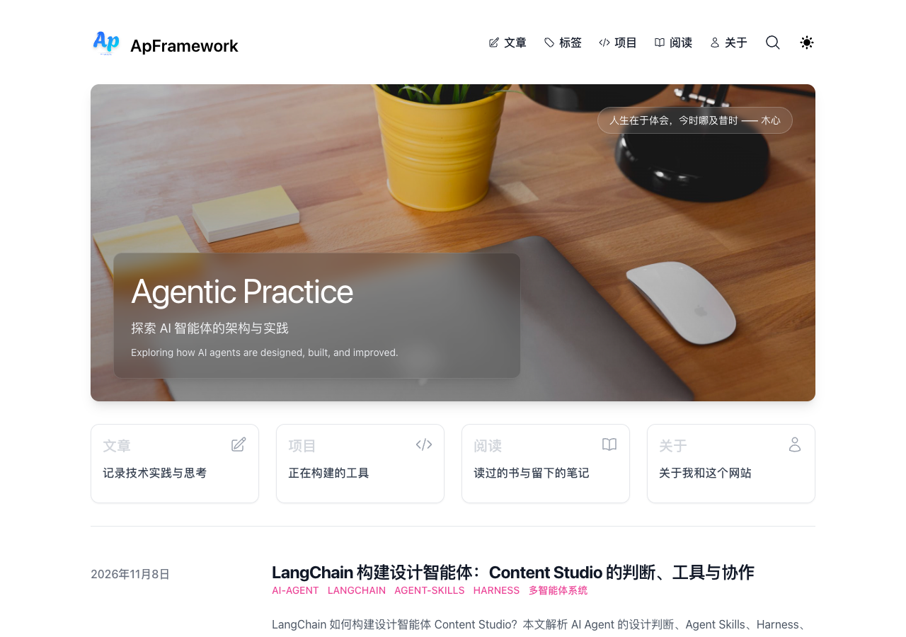
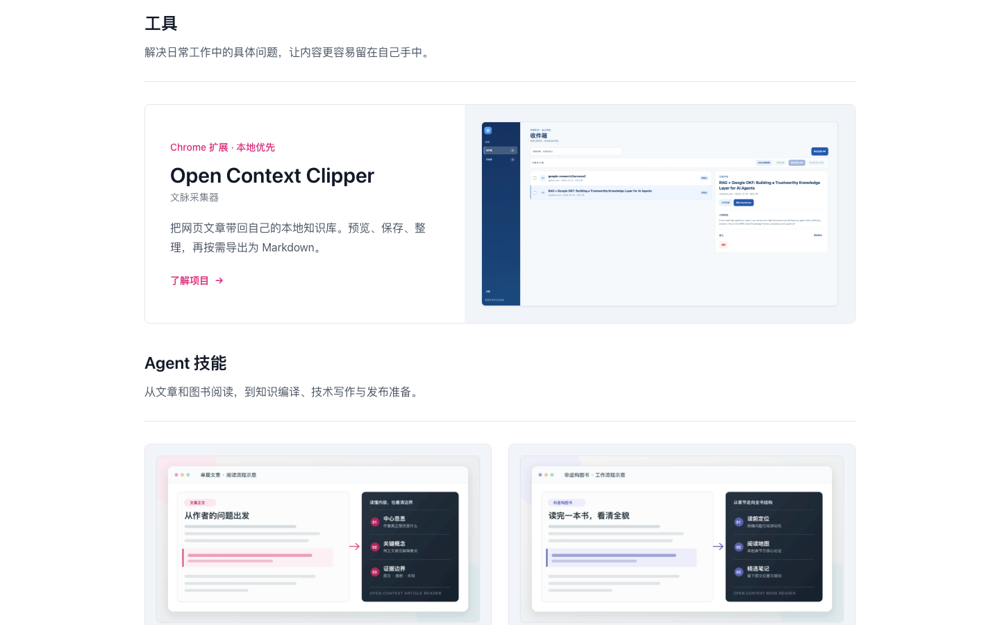
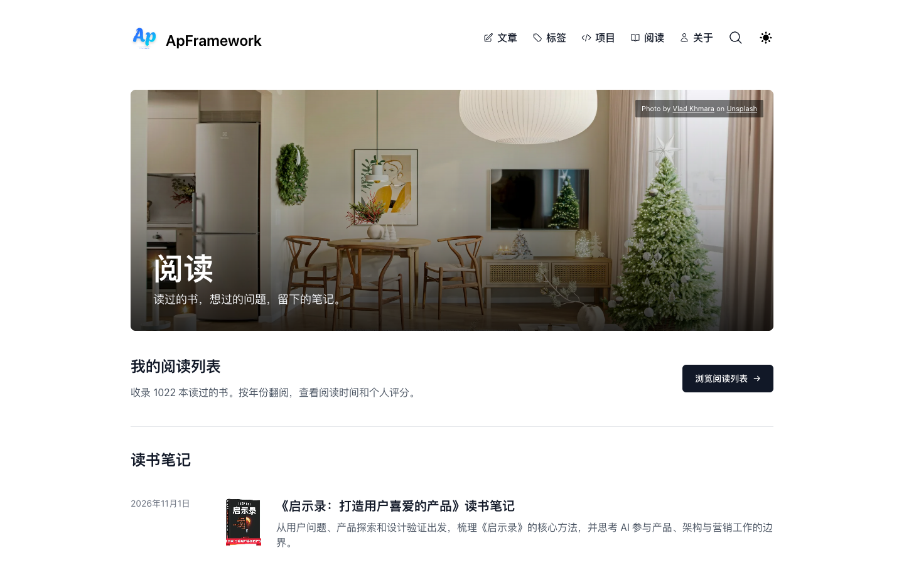
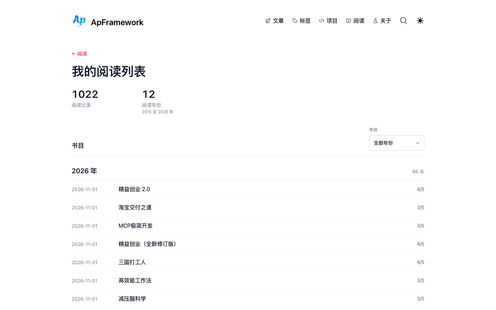

# ApFramework

> 记录 AI 智能体如何从想法走向真实系统：架构判断、工程实践、可用的工具，以及读书时留下的思考。

[访问网站](https://apframework.com/) · [读文章](https://apframework.com/blog) · [看项目](https://apframework.com/projects) · [翻阅读笔记](https://apframework.com/read)



ApFramework 是 Shoukai Huang 的个人站点。我在这里拆解 AI Agent 的设计与生产问题，也展示自己做的工具和阅读记录。上图及下方截图均来自本仓库实际运行的静态构建。

## 从这里开始

- **让 Agent 安全地做事**：[Agent 的 Tool Call 不是 Function Call：它是一条生产权限请求](https://apframework.com/blog/essay/2026-06-04-tool-call-not-function-call)——从一次工具调用出发，讨论授权、审批与审计为什么必须进入执行链路。
- **让数据查询有据可查**：[从本体到可信数据查询：RDF、SPARQL 与受控 SQL 实践](https://apframework.com/blog/essay/2026-11-07-ontology-to-trustworthy-query)——用项目管理案例串起业务语义、查询计划、日期口径和回归验证。
- **让 AI 系统经得起生产环境**：[生产 AI 系统设计：需求、容量、安全与质量评估](https://apframework.com/blog/essay/2026-10-31-production-ai-system-design)——以企业 IT helpdesk 为例，走一遍从需求到评估和持续发布的设计过程。

## 项目与阅读

- [Open Context Clipper](https://apframework.com/projects/open-context-clipper) 是一个本地优先的 Chrome 扩展：把网页文章预览、保存和整理到自己的知识库，再按需导出 Markdown。更多工具和 Agent Skills 见[项目页](https://apframework.com/projects)。
- [《启示录：打造用户喜爱的产品》读书笔记](https://apframework.com/read/notes/2026-11-01-apocalypse-product-notes) 从用户问题、产品探索和设计验证出发，也记录了对 AI 参与产品工作的思考。更多书和笔记见[阅读页](https://apframework.com/read)。

| [文章](https://apframework.com/blog/essay/2026-11-07-ontology-to-trustworthy-query) | [项目](https://apframework.com/projects) |
| :---: | :---: |
| [](https://apframework.com/blog/essay/2026-11-07-ontology-to-trustworthy-query) | [](https://apframework.com/projects) |

| [阅读](https://apframework.com/read) | [阅读列表](https://apframework.com/read/list) |
| :---: | :---: |
| [](https://apframework.com/read) | [](https://apframework.com/read/list) |

## 在本地运行

使用 [`.nvmrc`](.nvmrc) 指定的 Node.js 22.22.1。仓库内置 Yarn 3.6.1，无需全局安装 Yarn：

```sh
node .yarn/releases/yarn-3.6.1.cjs install --immutable
node .yarn/releases/yarn-3.6.1.cjs dev
```

打开 `http://localhost:3000` 即可浏览。评论和统计的本地配置是可选的；需要时复制 [`.env.example`](.env.example) 为 `.env.local` 并填入自己的配置。

### 构建与检查

```sh
EXPORT=1 UNOPTIMIZED=1 node .yarn/releases/yarn-3.6.1.cjs build
node .yarn/releases/yarn-3.6.1.cjs test
```

静态构建输出到 `out/`，构建后由 `scripts/postbuild.mjs` 生成 RSS。测试会读取本次构建的页面和 SEO 产物，因此请先构建再测试。[GitHub Actions](.github/workflows/ci.yml) 在推送到 `main`、提交拉取请求和手动触发时运行同样的检查。

## 内容与站点维护

| 内容 | 在仓库中 |
| --- | --- |
| 技术文章 | [`data/blog/`](data/blog/) 中的 MDX 文件 |
| 阅读笔记 | [`data/read/notes/`](data/read/notes/) 中的 MDX 文件 |
| 阅读记录 | [`config/read-books.json`](config/read-books.json) |
| 项目介绍 | [`data/projectsData.ts`](data/projectsData.ts) 等 |

文章和笔记至少填写 `title`、`date`，建议补充 `summary`；可用 `draft: true` 暂停公开。图片等公开资源放在 `public/static/`。栏目、RSS 与阅读数据的更多约定见[站点结构](docs/site-structure.md)。

`apframework.com` 的主站由阿里云服务器承载。这个仓库用于维护源码与备份；GitHub Actions 只负责构建和测试，不负责线上发布。静态导出不会执行 Next.js API 路由或 middleware，也不会自动应用 `next.config.js` 中的 redirects 和 headers；服务器上的跳转与响应头需要单独核对。

## 来源与许可

本站基于 [Tailwind Nextjs Starter Blog](https://github.com/timlrx/tailwind-nextjs-starter-blog) 改造。原项目的版权与 MIT 许可见 [LICENSE](LICENSE)。
