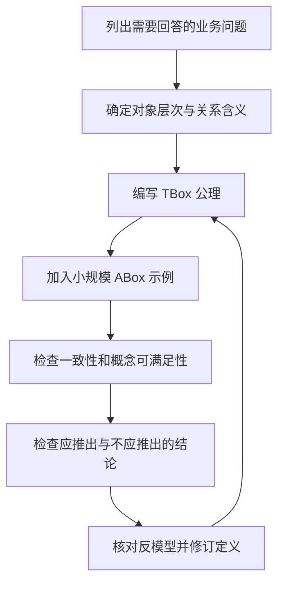

<figure className="flex flex-col items-center text-center">
  
  <figcaption>
    {'一个基本的描述逻辑：从概念到推理（Photo by '}
    <a href="https://unsplash.com/@barbarashaw?utm_source=unsplash&utm_medium=referral&utm_content=creditCopyText">
      {'B S'}
    </a>
    {' on '}
    <a href="https://unsplash.com/photos/book-open-on-wooden-surface-efgl-BzW_AQ?utm_source=unsplash&utm_medium=referral&utm_content=creditCopyText">
      {'Unsplash'}
    </a>
    {'）'}
  </figcaption>
</figure>

企业软件里的业务知识散落在表结构、代码、产品文档和专家经验中。即使把它们整理成一套术语和关系，仍有一个问题需要回答：根据这些知识，究竟能得出什么结论？

例如，知道一辆车安装了电机，能否把它归入“具有电驱动能力的车辆”？能否进一步断定它没有内燃机驱动单元？如果一种配置既要求存在内燃机，又要求所有驱动单元都不是内燃机，这种配置还有可能存在吗？

《An Introduction to Description Logic》第二章“A Basic Description Logic”（一个基本的描述逻辑）从ALC（**A**ttributive **L**anguage with **C**omplement，含补的定语语言）出发，将概念语言、知识库和推理联系起来。这些看似抽象的定义，恰好能帮助我们区分三种情况：结论必然成立、已有信息不足，以及条件彼此矛盾。

读这一章，我更关注它对建模的要求：每写下一条业务定义，都要能说明它允许哪些情况、排除哪些情况，以及能支持什么推理。

下面沿用原书的形式定义，用一个简化的车辆模型贯穿讨论。案例只用于说明逻辑含义，不代表车辆法规分类，也不是完整的产品配置模型。

## 目录

<TOCInline toc={props.toc} exclude="目录" toHeading={2} />

## 1. 让业务知识具有明确的含义

描述逻辑（Description Logics，DLs）是一族知识表示语言，用于以结构化、语义明确的方式表达某个应用领域的知识。这也是原书引言对它的基本定位。

它包含两个相互依赖的部分：一套用于组合概念的语言，以及一套规定表达式含义的形式语义。前者决定能够写什么，后者决定写下之后意味着什么。

如果图上画着“车辆 → 电机”，这条箭头可能表示安装、允许选装、型号适配，也可能表示某种统计关联。图形本身不能替代对关系的定义。描述逻辑要求把这些含义明确下来，使推理结果不依赖读图者的临场理解。

数据库、ER模型和程序语言同样有各自的语义。需要比较的是，它们支持哪些表达、如何解释这些表达，又能据此计算哪些结论。在DL中，推理考虑整个知识库，一般领域知识也参与其中。

### 表达能力需要付出计算代价

语言越丰富，推理所需的计算代价就越需要关注。讨论这种取舍时，有三个容易混淆的层次：

| 层次     | 含义                                                           | 不能由此保证什么                   |
| -------- | -------------------------------------------------------------- | ---------------------------------- |
| 可判定   | 存在算法，对该问题的每个输入都能在有限时间内终止并给出正确答案 | 不保证工程上足够快                 |
| 易处理   | 通常指相对于输入规模存在多项式时间算法                         | 不保证任意规模和实现都满足时延要求 |
| 实际可用 | 在选定任务、数据和资源条件下达到要求                           | 不代表最坏情况复杂度因此降低       |

描述逻辑通过约束表达方式，力求保住常见推理问题的可判定性；一些更受限的语言还追求易处理性。不同扩展单独可用，并不意味着组合之后仍具有相同性质。

原书引言回顾的历史也贯穿着这种取舍：从语义网络和框架出发，为知识表示建立精确语义；早期的结构包含算法对较弱语言高效且完备；随后，表算法等方法支持更丰富的表达，优化实现又把理论方法带入应用。语言设计与推理方法一直在共同演进。

ALC提供了一个具体起点：先弄清一种语言能表达什么、表达式意味着什么，再讨论如何推理。

## 2. 概念、角色和个体名：分别在说什么

描述一辆车及其部件时，我们既会说“车辆”“电机”这样的类别，也会说“具有驱动单元”这样的关系，还会指向某辆具体的车。在DL中，它们分别由概念名、角色名和个体名表达。

| 构件                      | 形式含义                                           | 示例                       |
| ------------------------- | -------------------------------------------------- | -------------------------- |
| 概念名（concept name）    | 在一个解释中表示元素集合，可对应一元谓词           | `Vehicle`、`ElectricMotor` |
| 角色名（role name）       | 在一个解释中表示元素之间的二元关系，可对应二元谓词 | `hasDriveUnit`             |
| 个体名（individual name） | 在一个解释中指向某个元素                           | `v1`、`m1`                 |

用这三类名称，可以写出：

$$
\mathsf{v1}:\mathsf{Vehicle},\qquad
\mathsf{m1}:\mathsf{ElectricMotor},\qquad
(\mathsf{v1},\mathsf{m1}):\mathsf{hasDriveUnit}.
$$

它们说的是：`v1`是一辆车，`m1`是一台电机，`v1`以`m1`为驱动单元。

“角色”在这里指二元关系，不是权限系统中的用户角色。`hasDriveUnit`这个名字本身也不限定关系两端的类别，更不自动赋予它传递性或其他业务含义。需要的约束必须写出来。

### VehicleModel究竟是概念还是个体

这取决于建模层次。假设研究对象包含“车型定义”和“实际车辆”：

```text
modelA : VehicleModel
car001 : Vehicle
(car001, modelA) : hasModel
```

`VehicleModel`是车型定义对象的类别，`modelA`是其中一个具体车型定义。另一种建模方式是用概念`ModelAVehicle`表示所有属于车型A的车辆，令`car001 : ModelAVehicle`。

这两种表达的对象层次不同，不能仅凭“车型A”这个业务名称把它们混用。若同时采用，需要再规定“关联车型定义”与“属于车辆类别”之间的联系。

原书第2.1节提醒我们，DL概念在语法层面是形式表达式，应用领域中一个概念的全部含义往往比这个表达式复杂得多。建模总是有目的的抽象。

## 3. ALC怎样组合概念

有了概念名和角色名，ALC便可以通过合取、析取、否定、存在限制和值限制，递归构造更复杂的概念描述。加上顶概念与底概念，语法可以写成下面的形式（原书定义2.1）：

$$
C,D ::= A\mid\top\mid\bot\mid\neg C\mid
C\sqcap D\mid C\sqcup D\mid\exists r.C\mid\forall r.C.
$$

这里的$A$是概念名，$r$是角色名，$C,D$可以是复合概念。ALC允许对任意概念描述取否定，不限于概念名。

> **名字就是能力清单。** 原书附录 A.3 的命名方案里，一个具体的 DL 由它可用的构造子与公理决定，名称只是把这份清单直接写进名字：ALC 就是在基本 DL「AL」上加入完全否定（complement）得到的；第 8 章的 SROIQ 也照这个规则读——S 是带传递角色的 ALC，R 表示角色盒（RBox），O、I、Q 分别是名义词、逆角色和限定数限制。

| 表达式        | 读法               | 在一个解释中的含义               |
| ------------- | ------------------ | -------------------------------- |
| $\top$        | 顶概念             | 解释域中的全部元素               |
| $\bot$        | 底概念             | 空集                             |
| $C\sqcap D$   | C且D               | 两个外延的交集                   |
| $C\sqcup D$   | C或D               | 两个外延的并集，允许同时属于二者 |
| $\neg C$      | 非C                | C的外延相对于整个解释域的补集    |
| $\exists r.C$ | 存在一个r目标属于C | 至少有一个这样的关系目标         |
| $\forall r.C$ | 所有r目标都属于C   | 不允许出现不属于C的r目标         |

例如：

$$
\mathsf{Vehicle}\sqcap
\exists\mathsf{hasDriveUnit}.\mathsf{ElectricMotor}
$$

表示“具有至少一个电机驱动单元的车辆”。这是描述对象集合的概念表达式，还没有断言哪个具体对象属于它，也没有给它命名。

否定也需要考虑范围。$\neg\mathsf{ElectricMotor}$包括解释域内所有不是电机的元素，可能包含车辆、人员或其他对象。若要表达“不是电机的驱动单元”，应写成：

$$
\mathsf{DriveUnit}\sqcap\neg\mathsf{ElectricMotor}.
$$

### “存在一个”和“全部都是”分别承诺了什么

$\exists r.C$承诺至少存在一个属于C的r目标，但没有限制其他r目标。$\forall r.C$限制全部r目标，却不承诺存在任何目标。

如果在某个解释中，一个对象没有任何r目标，它仍然满足$\forall r.C$。这是全称限制的空真，不是例外规则。

因此，“至少有一个驱动单元，而且所有驱动单元都是电机”可以写成：

$$
\mathsf{Vehicle}
\sqcap\exists\mathsf{hasDriveUnit}.\mathsf{ElectricMotor}
\sqcap\forall\mathsf{hasDriveUnit}.\mathsf{ElectricMotor}.
$$

另一个常见错误，是把“没有C类型的r目标”与“有一个不是C的r目标”混淆。原书引理2.3给出：

$$
\neg\exists r.C\equiv\forall r.\neg C,
\qquad
\neg\forall r.C\equiv\exists r.\neg C.
$$

“并非全部通过”需要一个不通过的反例；“一个通过的都没有”要求排除全部通过者。

## 4. TBox与ABox：一般知识和具体事实如何组合

根据定义2.4，ALC的一般概念包含公理（General Concept Inclusion，GCI）形如：

$$
C\sqsubseteq D.
$$

它要求C的每个元素也属于D。有限个GCI组成TBox。这里的左右两端都可以是复合概念，因此TBox能够表达的不仅是命名类别之间的层次。

等价公理是两个方向包含的缩写：

$$
C\equiv D
\quad\text{缩写了}\quad
C\sqsubseteq D\ \text{以及}\ D\sqsubseteq C.
$$

与TBox对应，ABox由有限个概念断言$a:C$和角色断言$(a,b):r$组成，记录具体个体的知识（定义2.6）。两者合在一起构成知识库（定义2.7）：

$$
\mathcal K=(\mathcal T,\mathcal A).
$$

TBox描述一般知识，ABox描述具体情境。数据库的schema与实例可以帮助建立初步类比，但两者不能直接等同，后面讨论的开放世界语义就是一个重要区别。

### 必要条件与充分条件，要看包含的方向

我们把“具有至少一个电机驱动单元的车辆”命名为`ElectricDriveVehicle`。先考虑只有一条公理的情况：

$$
\mathsf{ElectricDriveVehicle}\sqsubseteq
\mathsf{Vehicle}\sqcap
\exists\mathsf{hasDriveUnit}.\mathsf{ElectricMotor}.
$$

右边是成为`ElectricDriveVehicle`的必要条件。从左边可以推出右边，单凭这一条不能反过来认定类别。

如果业务人员认可右边也是充分条件，可以再加入反向包含，或直接写等价定义：

$$
\mathsf{ElectricDriveVehicle}\equiv
\mathsf{Vehicle}\sqcap
\exists\mathsf{hasDriveUnit}.\mathsf{ElectricMotor}.
$$

此时，知道一个对象是车辆并具有电机驱动单元，就足以识别它属于这个类别。

**单向包含同样能够推导类型。** 例如$\mathsf{Vehicle}\sqcap\exists\mathsf{hasDriveUnit}.\mathsf{ElectricMotor}\sqsubseteq\mathsf{ElectricDriveVehicle}$本身就提供了这个识别方向。应当检查公理给出了哪个推导方向，而不是把“能识别类别”归功于等价符号本身。

这个简化定义没有排除混合动力车辆。将它直接命名为“纯电动车”，或用“有电池”作为纯电动车的充分条件，都会让名称与定义不符。名字不会自动补齐没有写出的条件。

## 5. 解释、模型与蕴涵：什么才算必然成立

前面一直在用集合与关系理解表达式。现在把这种理解写得精确一些：一个解释由解释域和解释函数组成（原书定义2.2）：

$$
\mathcal I=(\Delta^{\mathcal I},\cdot^{\mathcal I}).
$$

$\Delta^{\mathcal I}$是非空解释域，$\cdot^{\mathcal I}$是解释函数。它把概念名映射到域的子集，把角色名映射到域上的二元关系；在引入ABox之后，也把个体名映射到域中的元素：

$$
A^{\mathcal I}\subseteq\Delta^{\mathcal I},\qquad
r^{\mathcal I}\subseteq\Delta^{\mathcal I}\times\Delta^{\mathcal I},\qquad
a^{\mathcal I}\in\Delta^{\mathcal I}.
$$

例如，可以取$\Delta^{\mathcal I}=\{v,m\}$，将`Vehicle`解释为$\{v\}$、`ElectricMotor`解释为$\{m\}$，将`hasDriveUnit`解释为$\{(v,m)\}$，并令`v1`指向$v$、`m1`指向$m$。

概念在这个解释中对应的集合称为外延。外延由解释决定，不能简单当成数据库当前已经列出的记录。

> **解释可以画成一张有向带标号图**（directed, labelled graph）：解释域中的每个元素是一个结点，结点用该元素所属的全部概念名标号；如果后一个结点对应的元素是前一个结点对应元素的 $r$-填充者，就有一条从前往后、标号为 $r$ 的边。表里的两个集合语义，读成图上的「有出边」与「所有出边都落在某集合」即可。

存在限制和值限制的区别，也可以直接从它们的集合语义中看出来（定义2.2）：

$$
\begin{aligned}
(\exists r.C)^{\mathcal I}
&=\{d\in\Delta^{\mathcal I}\mid
\exists e\in\Delta^{\mathcal I}: (d,e)\in r^{\mathcal I}\land e\in C^{\mathcal I}\},\\
(\forall r.C)^{\mathcal I}
&=\{d\in\Delta^{\mathcal I}\mid
\forall e\in\Delta^{\mathcal I}: (d,e)\in r^{\mathcal I}\Rightarrow e\in C^{\mathcal I}\}.
\end{aligned}
$$

一个解释只有满足知识库的全部公理和断言，才是这个知识库的模型。解释域可以包含未命名元素，也可以是无限的；概念的外延可以为空，即使解释域本身必须非空。

### 在一个模型中成立，还不是必然结论

知识库通常允许多个模型。逻辑蕴涵$\mathcal K\models\alpha$表示：**知识库的每个模型都满足$\alpha$。**

一个结论在某个模型里成立，还不能说明它在其他模型中也成立。反过来，只要找到一个满足全部已知知识、却不满足该结论的模型，就足以证明知识库不蕴涵这个结论。这样的模型称为反模型。

可以把模型暂时理解为“符合已知知识的一种可能安排”。这种说法帮助建立直觉，但逻辑上允许的安排未必满足没有写入知识库的物理、商业或法规要求。

增加公理会排除原先允许的模型。原书引理2.5指出，如果$\mathcal T\subseteq\mathcal T'$，那么$\mathcal T'$的每个模型也是$\mathcal T$的模型。模型空间可能缩小，也可能不变；如果被排除到一个模型都不剩，就发生不一致。

## 6. 回到车辆模型：已知、未知与开放世界

设`hasDriveUnit`表示“具有直接驱动单元”。下面全部是同一时刻、同一建模范围内的知识，不讨论时间变化。

把前面的定义放到一起，得到下面的TBox。其中，`NoCombustionDriveVehicle`表示“具有电驱动能力且没有内燃机驱动单元的车辆”。

$$
\begin{aligned}
\mathsf{ElectricMotor}&\sqsubseteq\mathsf{DriveUnit},\\
\mathsf{CombustionEngine}&\sqsubseteq\mathsf{DriveUnit},\\
\mathsf{ElectricMotor}\sqcap\mathsf{CombustionEngine}&\sqsubseteq\bot,\\
\mathsf{ElectricDriveVehicle}&\equiv
\mathsf{Vehicle}\sqcap\exists\mathsf{hasDriveUnit}.\mathsf{ElectricMotor},\\
\mathsf{NoCombustionDriveVehicle}&\equiv
\mathsf{ElectricDriveVehicle}\sqcap
\forall\mathsf{hasDriveUnit}.\neg\mathsf{CombustionEngine}.
\end{aligned}
$$

这里把电机和内燃机建模为互不相交的部件类别。复合总成应另行建模，不能把包含两者的总成直接当成两种部件本身。最后一个车辆类别也不是法规意义上的“纯电动车”定义：它只谈`hasDriveUnit`这个关系的目标，没有刻画全部能源系统或发动机用途。

ABox只有三条事实：

$$
\mathsf{v1}:\mathsf{Vehicle},\qquad
\mathsf{m1}:\mathsf{ElectricMotor},\qquad
(\mathsf{v1},\mathsf{m1}):\mathsf{hasDriveUnit}.
$$

### 可以推出电驱动类别

在知识库的每个模型中，`v1`都是车辆，且通过`hasDriveUnit`关联一个属于`ElectricMotor`的元素。因此它必然满足等价定义的右侧，得到：

$$
\mathcal K\models\mathsf{v1}:\mathsf{ElectricDriveVehicle}.
$$

同理可以推出$\mathcal K\models\mathsf{m1}:\mathsf{DriveUnit}$。这两个结论都没有直接出现在ABox中。

### 不能由“只记录一台电机”推出“没有内燃机”

下面两个模型都符合上述知识库：

| 内容                         | 模型一      | 模型二            |
| ---------------------------- | ----------- | ----------------- |
| 解释域                       | $\{v,m\}$   | $\{v,m,e\}$       |
| Vehicle外延                  | $\{v\}$     | $\{v\}$           |
| ElectricMotor外延            | $\{m\}$     | $\{m\}$           |
| CombustionEngine外延         | 空集        | $\{e\}$           |
| DriveUnit外延                | $\{m\}$     | $\{m,e\}$         |
| hasDriveUnit外延             | $\{(v,m)\}$ | $\{(v,m),(v,e)\}$ |
| ElectricDriveVehicle外延     | $\{v\}$     | $\{v\}$           |
| NoCombustionDriveVehicle外延 | $\{v\}$     | 空集              |

两个模型都让`v1`指向$v$、`m1`指向$m$。模型二额外包含一个未命名内燃机及其关系，原知识库并没有禁止它。

因此，原知识库既不能推出`v1`属于`NoCombustionDriveVehicle`，也不能推出它不属于这个类别。这正是原书第2.2.2节所讨论的开放世界假设（Open World Assumption，OWA）：未陈述、未推出的内容，不自动被当作假。

> **原书里的同一个问题，换到学校场景。** $\mathcal{A}_{ex}$ 断言 Betty 修读 Ph456，而 Ph456 是 PGC，并且这是她唯一被记录的课程。但知识库中没有任何语句排除她还修读别的课程：取一个把 $\mathsf{teaches}$ 外延扩大到含 $(b,c6)$ 的模型 $\mathcal{I}''$，只要 $c6$ 不属于 PGC，Betty 就不在 PG-Student 的外延里。所以 $\mathcal{K}_{ex}$ 并不蕴涵 `Betty : PG-Student`——「只记录了这门课」和「只修读这门课」是两件事。

“未知”描述的是知识库对结论的支持状态；ALC的经典模型语义并没有因此增加第三种真值。在每个具体模型中，元素是否属于一个概念仍然是确定的，只是不同模型可能给出不同结果。

如果业务已经确认没有内燃机驱动单元，可以补充：

$$
\mathsf{v1}:\forall\mathsf{hasDriveUnit}.\neg\mathsf{CombustionEngine}.
$$

结合已有的电驱动分类，就能推出`v1 : NoCombustionDriveVehicle`。但这条断言需要来自可靠业务信息，不能从“当前表里没有查到”自动补上。

### 空真与信息缺失是两个层次

“某个解释里确实没有r目标”，能够使$\forall r.C$空真成立。“ABox里没有记录r目标”，却不表示全部模型都没有r目标，也就不能直接推出全称限制。

反过来，若只断言`v2 : ElectricDriveVehicle`，等价定义要求每个模型都为`v2`提供某个电机驱动单元，即使ABox没有对应的命名部件。知识库可以保持一致。这不等于系统已经创建了一个可交付的BOM物料记录。

### 不同名称也不自动代表不同对象

本书默认不采用唯一名称假设（Unique Name Assumption，UNA）。不同个体名可以在一个模型中指向同一元素。例如跨系统名称`vehicle_001`和`customer_car_A`可能指向同一辆车。原书在 ABox 例子里甚至把 Hugo 和 Betty 解释成同一个元素 $h$——语义定义只要求个体名指向域中元素，只有采用 UNA 的逻辑才会额外要求 $a\ne b$ 时 $a^{\mathcal{I}}\ne b^{\mathcal{I}}$。

不采用UNA既不意味着它们必然相同，也不意味着实际完成了实体对齐。身份判断仍然需要知识支持，而且要注意所选语言能否表达需要的相等或不等断言。

## 7. 用推理检查类别、事实与矛盾

前面的车辆案例已经涉及两个问题：某个对象是否必然属于某类，以及已有知识是否允许某种情况。原书定义2.14将基本推理问题归纳为五种。每一种都需要分清，它问的是“存在一个模型”，还是“每个模型都如此”。

| 问题         | 形式条件                                                     | 对应的业务问题                         |
| ------------ | ------------------------------------------------------------ | -------------------------------------- |
| 概念可满足性 | 存在TBox的模型$\mathcal I$，使$C^{\mathcal I}\ne\varnothing$ | 在这些规则下，这类对象有没有可能存在？ |
| 概念包含     | 在TBox的每个模型中，$C^{\mathcal I}\subseteq D^{\mathcal I}$ | 每个C是否必然也是D？                   |
| 概念等价     | 在TBox的每个模型中，$C^{\mathcal I}=D^{\mathcal I}$          | 两种描述是否总对应同一集合？           |
| 知识库一致性 | 存在同时满足TBox和ABox的模型                                 | 这些规则与事实能否共同成立？           |
| 实例判断     | 在知识库的每个模型中，$a^{\mathcal I}\in C^{\mathcal I}$     | a是否必然属于C？                       |

可满足性、包含和等价在这里相对于TBox定义；知识库一致性和实例判断涉及TBox与ABox。说“这个概念可满足”时，需要知道它相对于哪组规则。

### 类别不可能存在，知识库仍可能一致

在前面的TBox中增加一个配置类别：

$$
\begin{aligned}
\mathsf{BadConfiguration}\equiv{}&
\mathsf{NoCombustionDriveVehicle}\\
&\sqcap\exists\mathsf{hasDriveUnit}.\mathsf{CombustionEngine}.
\end{aligned}
$$

假定有对象属于这个类别，它就必须有一个内燃机驱动单元；但`NoCombustionDriveVehicle`又要求所有驱动单元都不属于`CombustionEngine`。同一个关系目标被要求既属于又不属于该概念，因而不可能满足。

所以`BadConfiguration`相对于TBox不可满足，其外延在全部模型中都为空。前面的模型一仍然可以作为整个知识库的模型，只需将`BadConfiguration`解释为空集。

如果再加入断言：

$$
\mathsf{vBad}:\mathsf{BadConfiguration},
$$

知识库就不一致了：它要求一个元素属于永远为空的集合。

因此，建模时既要检查知识库一致性，也要检查重要概念的可满足性。整体一致，并不能排除某个业务类别永远不可能有实例。当然，空类别也可能是有意设计的，是否属于错误仍需业务判断。

经典语义下，不一致知识库没有模型，因而在形式上蕴涵任意语句。这样的输出无法作为有意义的业务结论；推理流程应当先处理一致性问题。

### 分类、检索与个体类型计算

基本问题可以组合成更方便的服务：

| 服务                         | 固定什么 | 计算什么                          |
| ---------------------------- | -------- | --------------------------------- |
| Classification，分类         | TBox     | 其中概念名之间的包含层次          |
| Instance retrieval，实例检索 | 概念C    | 知识库中哪些个体名被蕴涵为C的实例 |
| Realisation，个体类型计算    | 个体名a  | a被蕴涵属于哪些概念名             |

本书的realisation定义返回TBox中所有满足条件的概念名；有些工具会用最具体类别压缩展示，使用接口时要区分语义定义和显示方式。

分类图中的节点是概念，边表示包含；解释图中的节点是域元素，边表示角色关系。它们都可以画成图，但不能当成同一种图阅读。

### 多种服务为什么可以共用推理内核

原书定理2.17给出几种归约，其中两条尤其直观：

$$
\mathcal T\models C\sqsubseteq D
\quad\Longleftrightarrow\quad
C\sqcap\neg D\text{ 相对于 }\mathcal T\text{ 不可满足}.
$$

要证明“所有C都是D”，就检查是否可能存在“是C但不是D”的反例。

$$
(\mathcal T,\mathcal A)\models a:C
\quad\Longleftrightarrow\quad
(\mathcal T,\mathcal A\cup\{a:\neg C\})\text{ 不一致}.
$$

要判断a是否必然属于C，就尝试加入反面断言，看它是否与已有知识冲突。定义2.14中的这些基本问题都可以归约到知识库一致性，因此一个判定一致性的算法就能当作子例程，用来判定其余全部问题。但**这种归约不是万能的**：还有一些推理问题无法这样归约，即使可以，也可能带来问题规模上的指数级膨胀——合取查询回答（第7章）就是例子，对 ALCI 它是 2ExpTime-完备，而 ALCI 的知识库一致性只是 ExpTime-完备；对 SROIQ，一致性是 N2ExpTime-完备且可判定，合取查询回答的可判定性至今未决。

## 8. 定义展开、ALC扩展与其他逻辑

### 无环TBox可以展开，但展开有成本

如果TBox中的公理都是概念定义，就有可能通过展开定义来简化推理。但这需要额外限制。无环TBox是有限个概念定义$A\equiv C$组成的集合，满足两个条件：每个概念名最多在定义左侧出现一次，定义之间不存在直接或间接的自我依赖（定义2.9）。严格地说，「直接或间接的自我依赖」指的是概念定义之间**直接使用**（directly uses）关系的传递闭包无圈。

在这些条件下，可以逐步将定义名替换为对应表达式。不过，一般TBox中的任意GCI不能都当作这种宏定义处理，而且无环定义的完全展开也可能产生指数级膨胀。原书把这种一步到底的做法称为**急切的**（eager）展开，并在第4.2.2节给出改进的**惰性的**（lazy）展开方式，用来避免这种膨胀。

“定义里不能有环”只是这类受限TBox的要求，不是所有ALC知识库的语法禁令。循环定义不自动意味着知识库不一致，也不自动意味着ALC推理不可判定。

### 每种扩展都补上一类表达需求

ALC还不能表达“恰好四个车轮”这样的数量要求。第2.5节介绍的几种扩展，分别补充了不同的表达能力：

| 扩展              | 标记                   | 表达示例                                        | 需要留意的含义                                    |
| ----------------- | ---------------------- | ----------------------------------------------- | ------------------------------------------------- |
| 逆角色            | I                      | $\exists\mathsf{hasPart}^{-}.\mathsf{Vehicle}$  | 作为某辆车部件的对象；沿原关系反向访问            |
| 非限定数限制      | N                      | $\geq 2\,r$                                     | 至少两个不同的r目标                               |
| 限定数限制        | Q                      | $=4\,\mathsf{hasPart}.\mathsf{Wheel}$           | 恰好四个属于Wheel的目标，不限制其他类别目标的数量 |
| 名义词（nominal） | O                      | $\{\mathsf{supplierA}\}$                        | 外延恰为该个体名所指元素构成的单元素集合          |
| 角色层次          | H                      | $\mathsf{hasEngine}\sqsubseteq\mathsf{hasPart}$ | 前一个关系的每对元素也属于后一个关系              |
| 传递角色          | 通常以S替换名称中的ALC | $\mathsf{Trans}(\mathsf{partOf})$               | 若a属于b且b属于c，就推出a属于c                    |

数量限制数的是不同域元素，不是不同字符串名称。不采用UNA时，列出四个部件名并不足以保证它们表示四个不同部件。等量限制$=n\,r.C$是上下界限制的合取缩写。

传递性也必须符合所选关系的业务含义。“直接组成”通常不应自动传递；可以把直接关系与“直接或间接组成”分开表达。第2.5.5节还区分传递角色与传递闭包：声明s传递且包含r，并不能强制s恰好是包含r的最小传递关系。

这些扩展的组合仍需要检查语言限制。逆角色、数量限制、传递性各有用途，但“全部打开”不构成选型理由。

> **组合不是免费的。** 原书附录 A.3 指出：若不加限制地把 SHIQ 这个名字所指示的构造子组合起来，会得到一个推理问题不可判定的 DL。所以 SHIQ 的限定数限制被限制在**简单角色**（没有传递子角色的角色）上，SROIQ 这类逻辑的复杂角色包含也必须限于**正则**的角色包含公理集合。名字里写出的每一项能力，都附带自己的适用条件。

### 与一阶逻辑和模态逻辑的联系

第2.6节说明，ALC可以通过保持语义的标准翻译写成一阶逻辑。例如，前面的电驱动车辆定义对应：

$$
\begin{aligned}
\forall x\bigl(\mathsf{ElectricDriveVehicle}(x)\leftrightarrow{}&
\mathsf{Vehicle}(x)\land\\
&\exists y(\mathsf{hasDriveUnit}(x,y)\land\mathsf{ElectricMotor}(y))\bigr).
\end{aligned}
$$

DL语法省去了显式变量，但仍然表达量化关系。ALC的受限表达落在可判定的一阶逻辑片段内；仅仅使用一元、二元谓词，并不足以保证任意逻辑语言可判定。

> **翻译本身就是可判定性的来源。** 标准翻译由两个函数 $\pi_x$ 与 $\pi_y$ 组成，它们交替传递那个唯一的自由变量：$\pi_x(\exists r.C)=\exists y.(r(x,y)\wedge\pi_y(C))$，$\pi_y(\forall r.C)=\forall x.(r(y,x)\Rightarrow\pi_x(C))$。知识库的翻译只用到 $x$、$y$ 两个变量，因此落在**二变量片段**里；量化形式又相当受限，因此也落在**守卫片段**里。这两个片段的可满足性都已知道可判定（分别是非确定性与确定性指数时间），于是 DL 的复杂性上界可以顺带「免费」得到。

ALC概念还与多模态K的公式对应：$\exists r.C$对应沿r“存在可达目标满足C”，$\forall r.C$对应沿r“全部可达目标满足C”。原书给出的映射 $\pi$ 写出来很短：$\pi(\forall r.C)=[r]\pi(C)$，$\pi(\exists r.C)=\langle r\rangle\pi(C)$，概念名当作命题变元、角色名当作模态参数。不过，TBox还需要表达全局成立的条件：每个 $C\sqsubseteq D$ 都要在克里普克结构的每个世界里成立，这要用到**全称模态**，一个被解释为全关系的特殊模态参数 $U$。ABox也不能直接当作普通模态命题处理，它对应的是**名义词**（nominal）——只在唯一一个世界中成立的命题变元——以及用来指回那个世界的 @ 算子。这种对应揭示了概念表达式之间的联系，并不意味着可以忽略知识库的其他部分。

## 9. 从逻辑模型走向知识平台

把这些概念放回工程中，起点仍然是领域词汇：我们要描述哪些对象、区分哪些类别、回答什么问题。原书第1.2节介绍的应用流程，也是先用TBox形式化领域知识，再利用推理服务检查概念和知识库。有些应用只使用TBox，有些还需要组织或访问ABox与数据库中的数据。

对于一个小型行业知识模型，我会从下面的迭代开始：



我会为每个知识模型保留三类测试：应当推出的结论、信息不足时不应推出的结论，以及应当识别为矛盾的组合。前面的车辆案例覆盖了这三种情况。

这里的“可满足”只意味着在已写入的知识下逻辑上允许存在，并不证明车辆真的能生产、安全运行或满足法规。数值计算、时序、例外、数据完整性和现实适配，都需要按任务加入相应模型或软件能力。

系统职责也应分别落实：

| 职责                             | 可采用的工程位置             |
| -------------------------------- | ---------------------------- |
| 表达概念含义、计算包含和逻辑后果 | 本体与相应推理服务           |
| 存储事实、查询大规模数据         | 数据库、图存储及访问层       |
| 检查必填、格式、业务提交条件     | 校验器、数据库约束或应用服务 |
| 执行状态变更并保护事务不变量     | 领域模型及事务边界           |

这些是职责边界，具体产品可以组合实现。数据库和图系统同样可以承载规则与推理能力；DL并不要求把所有数据迁移到某一种存储。

在此前的[《Ontology与DDD的边界：从语义模型到领域模型》](/blog/essay/2026-05-31-ontology-vs-ddd)中，我讨论过语义建模与业务行为的分工。ALC让语义这一侧变得更具体：一个定义如何约束模型，一条结论为什么成立，以及某个判断究竟还缺少什么依据。

领域知识平台的价值最终要由业务结果检验：是否发现了原先遗漏的矛盾，是否澄清了类别之间的关系，是否减少了重复的人工判断。把术语写成公理，为这些检验提供了明确的对象。

## 10. 用例子和反例检验定义

理解一个定义，最有效的办法之一，是看看它允许什么，又排除了什么。原书第1.4节建议通过构造例子和画模型来学习；在业务建模中，这同样是一种检查假设的办法。

前面的车辆模型留下了三个值得反复追问的问题：

1. 给一个只表达必要条件的公理补上反向包含，会多推出哪些结论？
2. “只记录电机，因此没有内燃机”为什么站不住脚？哪个模型能反驳它？
3. 一个类别不可能有实例，为什么知识库仍可一致？再声明它有实例时，矛盾出在哪里？

这些问题把公式与业务判断连了起来。定义是否准确，不只看名称是否贴切，也要看它在具体例子和反例中产生什么后果。对我而言，这是读完这一章最值得带回日常建模工作的习惯。

> **一句话抓住这一章**：ALC 用极少的构造子换来可判定的推理；此后每一章都是在「加构造子」与「保住可判定／易处理」之间做取舍。

## 附录：概念记忆卡

| 正面：问题                              | 背面：回答                                                       |
| --------------------------------------- | ---------------------------------------------------------------- |
| DL是什么？                              | 一族具有形式语义的知识表示语言；具体语言提供不同构造与推理性质。 |
| 概念、角色、个体名分别解释为什么？      | 元素集合、二元关系、域中的元素。                                 |
| 概念表达式与概念外延有什么区别？        | 前者是语法，后者是表达式在某个解释下表示的集合。                 |
| $\exists r.C$保证什么？                 | 至少一个r目标属于C；不限制其他目标。                             |
| $\forall r.C$保证什么？                 | 全部r目标属于C；不保证存在目标。                                 |
| $\neg C$就是另一个业务类别吗？          | 不是；它是相对于整个解释域的补集，需要另加业务范围。             |
| $C\sqsubseteq D$的方向是什么？          | C是D的充分条件，D是C的必要条件。                                 |
| $C\equiv D$增加了什么？                 | 同时具有两个方向的包含。                                         |
| 只有等价定义才能推导类别吗？            | 否，单向GCI也能沿蕴涵方向推导。                                  |
| TBox与ABox分别放什么？                  | 一般领域公理；具体个体的概念与角色断言。                         |
| 什么是模型？                            | 满足给定知识库全部公理和断言的解释。                             |
| 什么是蕴涵？                            | 在知识库的每个模型中都成立。                                     |
| 找到一个模型能证明什么？                | 能证明知识库一致；不能单凭它证明任意结论被蕴涵。                 |
| OWA意味着什么？                         | 没有陈述或推出的事实，不自动当作假。                             |
| OWA与空真怎么区分？                     | 前者涉及知识允许哪些模型；后者涉及一个解释中全称条件的成立。     |
| 不采用UNA意味着什么？                   | 不同个体名可以指向同一个元素，但不强制相同。                     |
| 概念可满足与知识库一致有什么区别？      | 前者问某类能否非空；后者问全部知识能否共同成立。                 |
| 概念不可满足会让知识库不一致吗？        | 未必；要求该概念存在实例时才会产生相应冲突。                     |
| Classification与realisation有什么区别？ | 前者求概念层次；后者求某个个体被蕴涵所属的概念名。               |
| 怎样把包含检查变成反例检查？            | 检查$C\sqcap\neg D$是否不可满足。                                |
| 数量限制数什么？                        | 不同关系目标元素，不是名字数量。                                 |
| 传递性等于传递闭包吗？                  | 不等于；闭包还要求是包含原关系的最小传递关系。                   |
| 可判定意味着实际足够快吗？              | 不意味着，仍需针对任务和数据评估成本。                           |
| 逻辑一致能证明模型忠实于业务吗？        | 不能，业务定义、事实质量和建模范围仍需验证。                     |

## 原书定位与参考资料

Franz Baader, Ian Horrocks, Carsten Lutz, Uli Sattler. _An Introduction to Description Logic_. Cambridge University Press, 2017。本文主要围绕第2章 **A Basic Description Logic**（书内第10—49页）展开，背景与学习方法参照第1章 **Introduction**（书内第1—9页）。

下表列出主要概念在原书第二章中的位置，便于回查定义和推导。

| 原书内容                   | 对应主题                            | 本文位置    |
| -------------------------- | ----------------------------------- | ----------- |
| 2.1，定义2.1、2.2，引理2.3 | ALC语法、解释与构造子的集合语义     | 第2、3、5节 |
| 2.2，定义2.4、2.6、2.7     | GCI、TBox、ABox与知识库模型         | 第4—6节     |
| 2.2.3，定义2.9             | 无环TBox及展开的条件                | 第8节       |
| 2.3，定义2.14、定理2.17    | 推理问题、服务与归约                | 第7节       |
| 2.4                        | 用推理结果反馈建模                  | 第7、9节    |
| 2.5，定义2.18—2.22         | I、N、Q、O、H、传递角色分别增加什么 | 第8节       |
| 2.6—2.7                    | 与其他逻辑的联系及后续文献入口      | 第8节、本节 |

形式定义按原书重述；车辆案例与工程分工是为理解这些定义而作的解释和应用推演。
