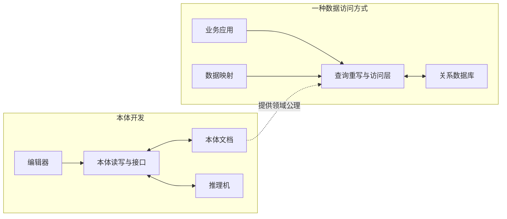

<figure className="flex flex-col items-center text-center">
  
  <figcaption>
    {'本体语言与应用：从描述逻辑到OWL（Photo by '}
    <a href="https://unsplash.com/@barbarashaw?utm_source=unsplash&utm_medium=referral&utm_content=creditCopyText">
      {'B S'}
    </a>
    {' on '}
    <a href="https://unsplash.com/photos/book-open-on-wooden-surface-efgl-BzW_AQ?utm_source=unsplash&utm_medium=referral&utm_content=creditCopyText">
      {'Unsplash'}
    </a>
    {'）'}
  </figcaption>
</figure>

两个系统都记录了“车辆具有电机”，却不一定会把这辆车归入同一个类别。一个系统把它视为电驱动车辆，另一个还要求额外条件。即使字段名称统一，分类依据也可能不同。

知识交换需要传递事实，也需要传递解释事实的公理。

《An Introduction to Description Logic》第8章“Ontology Languages and Applications”（本体语言与应用），讨论的正是描述逻辑怎样进入标准语言、工具和应用。接着[上一篇对基本描述逻辑的讨论](/blog/essay/2026-09-26-description-logic-from-concepts-to-reasoning)，这次的问题是：如何把业务定义交给软件理解，又怎样判断软件得出的结论是否符合预期？

OWL把描述逻辑连接到标准化的本体表达和工具体系。但模型是否适合业务，仍取决于表达能力、推理任务与适用边界。下面继续使用简化的车辆案例；这些例子用于解释语义，不代表车辆法规分类或经过工业验证的配置模型。

## 目录

<TOCInline toc={props.toc} exclude="目录" toHeading={2} />

> **阅读地图：先抓住六个动作。** RDF把事实组织成图；OWL把领域规则写成公理；SROIQ说明这些公理可以由哪些逻辑构件组成；模型给公理提供一种可能的解释；推理机寻找所有合法解释共同保证的结论；应用系统再把这些结论用于分类、查询和检查。阅读后文时，可以一直追问两件事：**我们明确写下了什么？这些内容必然推出什么？**

## 1. 业务定义写成公式之后，还缺什么

描述逻辑提供概念、角色、公理和形式语义。进入软件系统后，还要解决名称如何标识、文档如何交换、工具如何读写，以及推理服务怎样接入等问题。

OWL（Web Ontology Language，Web本体语言）为此提供了标准化表达。原先熟悉的构件，在OWL中有相应的名称：

| 描述逻辑中的构件 | OWL中的对应                 | 本文例子                   |
| ---------------- | --------------------------- | -------------------------- |
| 概念             | 类（Class）                 | `Vehicle`、`ElectricMotor` |
| 角色             | 对象属性（ObjectProperty）  | `hasDriveUnit`             |
| 个体名           | 具名个体（NamedIndividual） | `v1`、`m1`                 |
| 概念包含公理     | 子类公理（SubClassOf）      | 电机是驱动单元             |

TBox、ABox与RBox仍有助于区分概念知识、个体事实和角色知识，不过OWL把这些内容统一组织为公理，并不要求分成三个独立文件。

这里的“本体”不是又一种数据库产品，而是用来明确表达领域知识的对象。OWL也不会替我们决定“电驱动车辆”应该如何定义。它能做的是让选定的定义具有明确含义，使不同工具有共同的解释依据。

这里会反复出现几个看似抽象、实际非常关键的词：

| 术语                   | 通俗理解                                                                             |
| ---------------------- | ------------------------------------------------------------------------------------ |
| 解释（interpretation） | 先设想一个可能的世界，再决定每个类包含哪些对象、每个属性连接哪些对象、每个名称指向谁 |
| 满足（satisfaction）   | 这个可能世界没有违反给定的某条公理                                                   |
| 模型（model）          | 一个同时满足全部相关公理的解释，不是数据库里的“数据模型”                             |
| 蕴涵（entailment）     | 结论在知识库的每一个模型中都成立，因此不依赖我们挑选哪一种可能世界                   |

所以，推理机不是根据经验猜答案，而是在公理允许的全部可能情况中寻找共同结论。知识库若至少存在一个模型，就称为一致或可满足；如果一个模型都不存在，说明这些公理无法同时为真。

## 2. RDF、RDFS与OWL：分清图、词汇和语义

讨论OWL时，很容易把“怎么存下来”和“意味着什么”混在一起。先看一个RDF三元组：

```turtle
@prefix : <https://example.org/vehicle#> .

:v1 :hasDriveUnit :m1 .
```

主语是车辆，谓语是关系，对象是电机。这里的前缀把简写展开为IRI，即国际化资源标识符。一般RDF图中，主语也可以是空白节点，对象还可以是字面量，例如字符串或数值；不是每个位置都只能放IRI。

`rdf:type`用于表达类型，`rdfs:subClassOf`用于表达类之间的包含关系。RDF与RDFS有模型论语义，不能说它们“只是图，没有逻辑含义”。OWL在此基础上提供更丰富的本体表达能力，例如类的等价、不相交和属性限制。[W3C的RDF语义规范](https://www.w3.org/TR/rdf11-mt/)明确给出了RDF与RDFS的解释规则。

| 所讨论的层次 | 典型对象                                    | 不能由此得到的保证                       |
| ------------ | ------------------------------------------- | ---------------------------------------- |
| 数据模型     | RDF图与三元组                               | 能画成图，不代表已表达全部业务约束       |
| 词汇与公理   | 类型、子类、等价类、属性限制                | 名字相同，不代表各方采用相同定义         |
| 具体语法     | Turtle、RDF/XML、函数式语法、Manchester语法 | 文件能解析，不代表符合OWL 2 DL的全部限制 |
| 形式语义     | RDF语义、OWL直接语义、OWL基于RDF的语义      | 语义确定，不代表数据完备或推理足够快     |

原书用函数式语法、RDF/XML和Manchester语法展示同一组知识。这里额外用Turtle展示简单三元组，后文主要使用接近公理结构的函数式语法。表达同一组公理时，换一种写法并不会自动增加逻辑能力。

OWL 2有两条需要分清的语义路线：**直接语义（Direct Semantics）** 解释OWL的结构化公理，与描述逻辑紧密对应；**基于RDF的语义（RDF-Based Semantics）** 在RDF图上解释OWL词汇。

这里可以把“语法”和“语义”分成两个问题。语法回答一条知识怎样写进文件；语义回答所有满足这些公理的解释必须具有什么性质。直接语义先把文档识别为`SubClassOf`、`EquivalentClasses`等OWL结构化公理，再解释这些公理；基于RDF的语义则直接从三元组图解释OWL词汇。两条路线的区别是解释入口，不是文件扩展名。

后文以 **OWL 2 DL及其直接语义** 为范围。任意使用OWL词汇的RDF图，不一定满足OWL 2 DL的结构与全局限制。OWL Full允许更自由的表达，但一般推理不再有可判定性保证；这不等于RDF上的所有推理都不可判定。

## 3. 把一个车辆定义写成OWL

继续采用一个有意简化的定义：电驱动车辆，就是至少具有一个电机驱动单元的车辆。

$$
\mathsf{ElectricDriveVehicle}\equiv
\mathsf{Vehicle}\sqcap
\exists\mathsf{hasDriveUnit}.\mathsf{ElectricMotor}.
$$

这个等价式同时表达必要条件与充分条件。电驱动车辆必须满足右侧条件；满足右侧条件的对象，也必定属于这个类。它没有排除内燃机。

把等价符号拆成两个方向，就更容易读：

```text
是电驱动车辆 ──必要条件──▶ 是车辆，并且至少有一个电机驱动单元
是车辆，并且至少有一个电机驱动单元 ──充分条件──▶ 是电驱动车辆
```

如果只写`ElectricDriveVehicle ⊑ ...`，就只有第一个方向：可以用定义检查已知的电驱动车辆，却不能凭右侧条件自动完成分类。`EquivalentClasses`或数学符号`≡`才同时给出两个方向。

下面是一份带前缀、声明与本体包裹的最小函数式语法示例：

```text
Prefix(:=<https://example.org/vehicle#>)

Ontology(<https://example.org/vehicle>
  Declaration(Class(:Vehicle))
  Declaration(Class(:DriveUnit))
  Declaration(Class(:ElectricMotor))
  Declaration(Class(:ElectricDriveVehicle))
  Declaration(ObjectProperty(:hasDriveUnit))
  Declaration(NamedIndividual(:v1))
  Declaration(NamedIndividual(:m1))

  SubClassOf(:ElectricMotor :DriveUnit)
  EquivalentClasses(
    :ElectricDriveVehicle
    ObjectIntersectionOf(
      :Vehicle
      ObjectSomeValuesFrom(:hasDriveUnit :ElectricMotor)
    )
  )
  ObjectPropertyDomain(:hasDriveUnit :Vehicle)
  ObjectPropertyRange(:hasDriveUnit :DriveUnit)

  ClassAssertion(:Vehicle :v1)
  ClassAssertion(:ElectricMotor :m1)
  ObjectPropertyAssertion(:hasDriveUnit :v1 :m1)
)
```

`ObjectIntersectionOf`对应合取，`ObjectSomeValuesFrom`对应存在限制，`EquivalentClasses`把两边联系为等价类表达式。`Declaration`声明名字的使用类别，并不声明某个类一定有实例。

根据这些公理，`v1`属于`ElectricDriveVehicle`，`m1`属于`DriveUnit`。这些是语义上应当成立的结论；没有关于内燃机的记录，则不足以推出`v1`没有内燃机。

### 为什么“没有记录”不能当成“没有”

描述逻辑中的蕴涵要求一个结论在知识库的**所有模型**中都成立。可以设想两个都满足当前公理的模型：在第一个模型里，`v1`只有电机；在第二个模型里，`v1`既有电机，也有内燃机。当前定义只要求“至少存在一个电机驱动单元”，没有排除第二种情况。

因此，“`v1`没有内燃机”并非必然结论。这就是开放世界假设（Open World Assumption，OWA）在本例中的具体表现：没有写下来的事实保持未知，而不是自动判为假。若业务确实要求排除内燃机，需要增加明确的排除公理；若只是检查某个字段是否必填，则应交给数据校验机制，而不是靠开放世界推理猜测。

阅读一次推理结果时，可以先区分三种情况：结论被蕴涵，可以回答“是”；结论的否定被蕴涵，可以回答“否”；两边都推不出来，只能回答“未知”。这只是理解查询结果的办法，并不表示OWL采用三值逻辑。关键是：**没有证明为真，不等于已经证明为假。**

### domain和range会推导类型

示例中的两条公理值得单独看：

```text
ObjectPropertyDomain(:hasDriveUnit :Vehicle)
ObjectPropertyRange(:hasDriveUnit :DriveUnit)
```

它们的含义是：凡是`hasDriveUnit`关系的起点，都属于`Vehicle`；凡是终点，都属于`DriveUnit`。

因此，即使只新增`hasDriveUnit(x, y)`，没有预先写明两端类型，也可以推出`Vehicle(x)`与`DriveUnit(y)`。它们不是“起点未登记为车辆就拒绝写入”的数据库检查。

如果还断言`x`是某类对象，并声明该类与`Vehicle`不相交，这些公理才可能一起导致不一致。例如，额外假定`Vehicle`与`Workshop`不相交，却把一个已声明为`Workshop`的对象写成这条关系的起点，就产生了冲突。

这也是建模时有用的诊断线索：错误可能出在关系方向、domain定义或已有类型，而不仅是数据少填了一项。相关解释见[OWL 2直接语义中的对象属性公理](https://www.w3.org/TR/owl2-direct-semantics/#Object_Property_Axioms)。

### 对象属性和数据属性连接不同的对象

`hasDriveUnit`把车辆连接到另一个领域对象。额定功率、编号等属性则可以连接到数据值，用数据属性（DataProperty）表示。

OWL区分对象域与数据域。数据范围可以限制数值属于某个区间，但不能因此把OWL当作任意算术求解器。例如，“整车功率等于若干电机功率按某个工况公式计算的结果”并不是加一个数据范围就能表达的。

模型中哪些是对象、哪些是值，以及哪些计算应由程序承担，需要分别作出决定。

## 4. 关系也需要建模：从ALC到SROIQ

基础ALC已经能组合概念，但它不能覆盖很多关系层面的业务知识：直接部件属于整体，部件层次可以逐级向上追溯，关系还可能存在逆关系或数量要求。

原书用SROIQ说明OWL 2 DL背后的主要逻辑能力。字母可以作为索引：S以ALC加传递角色为基础，R强调丰富的角色公理，O表示名词概念（nominals），I表示逆角色，Q表示限定数量限制。OWL 2 DL与它紧密对应，但还涉及数据类型、键等内容，不能简单画等号。

原书定义8.1—8.3可以先读成三个逐层扩大的问题：

| 原书定义           | 回答的问题                               | 放进知识库的内容                           |
| ------------------ | ---------------------------------------- | ------------------------------------------ |
| 定义8.1：RBox      | 关系本身怎样组合、包含或传播？           | 属性链、传递性、对称性、不相交等角色公理   |
| 定义8.2：SROIQ概念 | 哪些类表达式是合法的？                   | 合取、否定、存在限制、Self、限定数量限制等 |
| 定义8.3：知识库    | 关系规则、类定义和个体事实怎样合在一起？ | `K = (R, T, A)`，即RBox、TBox与ABox        |

可以把TBox看成“领域词义和分类规则”，ABox看成“当前知道的具体事实”，RBox看成“关系自身的规则”。一个知识库模型必须同时满足三者；把它们分成三个Box是理解上的分工，不意味着OWL工程中一定保存为三个文件。

### 直接部件与部分整体关系

后面的代码均为教学片段，沿用前面的前缀；若组装成完整文档，还需补齐新名称声明与本体包裹。

```text
SubObjectPropertyOf(:directPartOf :partOf)
TransitiveObjectProperty(:partOf)

ObjectPropertyAssertion(:directPartOf :bearing1 :motor1)
ObjectPropertyAssertion(:directPartOf :motor1 :vehicle1)
```

第一条公理说，直接部件关系也是部分整体关系。第二条赋予`partOf`传递性。因此可以推出轴承是车辆的一部分，却不能据此推出轴承是车辆的**直接**部件。

这不是`direct`这个单词带来的行为，而是两种属性采用了不同的公理。OWL也不会因为属性叫`partOf`，就自动认为它具有传递性。

### 属性链组合的是关系含义

假定`locatedIn`用于表示故障记录所定位的部件或其所属整体，可以增加：

```text
SubObjectPropertyOf(
  ObjectPropertyChain(:locatedIn :partOf)
  :locatedIn
)
ObjectPropertyAssertion(:locatedIn :fault1 :bearing1)
```

它表达：如果某故障定位在一个部件，而该部件属于某整体，那么该故障也可以归到这个整体的位置范围。结合前面的事实，可推出`fault1`定位在`motor1`，进而定位在`vehicle1`。

把这条链逐步展开会更直观：

```text
两步路径：fault1 --locatedIn--> bearing1 --partOf--> motor1
逻辑捷径：fault1 --------------locatedIn--------------> motor1
```

属性链为两步路径增加了一条逻辑上的“捷径”。因为`motor1 partOf vehicle1`，同一规则还可以继续得到`fault1 locatedIn vehicle1`。

**这是故障位置的归类，不是物理故障传播。** 它没有证明整个电机已失效，更没有证明整车不能行驶。是否能采用这条链，取决于业务对`locatedIn`的定义。

### 表达能力必须与限制一起理解

RBox容纳这类角色公理。此外，局部自反表达式`ObjectHasSelf(R)`描述与自己具有关系R的对象；负对象属性断言明确否定某一对对象之间的关系，不是把没记录的关系一律判为假。

可以把RBox想成一套“道路生成规则”。传递性和属性链允许系统从多段道路推出一条捷径；正则性要求这些生成规则仍能由有限机制掌握，不能无约束地相互缠绕。简单属性则是不会被这类捷径扩张的关系，适合拿来做精确计数。这个类比只帮助建立直觉，最终是否合法仍由OWL 2 DL的正式全局限制决定。

这些构造不能任意组合。OWL 2 DL通过属性层次的正则性等全局条件限制复杂的相互依赖。这里的**简单对象属性**，可以先理解为“不会因为传递性或属性链而产生任意长度捷径的属性”。传递属性是典型的非简单属性；如果一条非平凡属性链推出属性`T`，`T`及其上位属性也是非简单的，但仅仅出现在链的左侧，并不会让一个属性自动变成非简单。

数量限制和`ObjectHasSelf`必须使用简单属性；非自反、非对称和属性不相交公理中的属性同样受到这一限制。[OWL 2结构规范](https://www.w3.org/TR/owl2-syntax/#Global_Restrictions_on_Axioms_in_OWL_2_DL)给出了正式定义。限制这些组合的目的不是减少建模便利，而是避免“路径捷径”和计数相互作用后破坏推理的可判定性。

因此，在上面的公理集合中，`partOf`不能直接用于“恰好两个”的对象数量限制；`directPartOf`仍可保持简单性，用来描述直接部件的数量。作为传递属性的子属性，并不会单独使它变成非简单属性。不过，增加其他链或层次公理后仍要重新检查，不能只凭名字判断。

限定数量限制数的是不同的对象，不是不同的名称。若要表达“这两个零件确实不同”，还需要相应的不同个体断言。正则性也不能简化成“所有关系都必须无环”。

### 引理8.4在说什么

原书引理8.4指出，几种常见角色公理可以用已有构造等价地改写：

| 专用写法   | 等价写法                                       | 直觉                           |
| ---------- | ---------------------------------------------- | ------------------------------ |
| `Trans(R)` | $R \circ R \sqsubseteq R$                      | 连续走两段R，仍可得到一条R关系 |
| `Sym(R)`   | $R \sqsubseteq R^{-}$                          | 有正向R，就有反向R             |
| `Ref(R)`   | $\top \sqsubseteq \exists R.\mathsf{Self}$     | 每个对象都与自己具有R关系      |
| `Irref(R)` | $\top \sqsubseteq \neg\exists R.\mathsf{Self}$ | 没有对象与自己具有R关系        |

这里的“等价”是指两种写法约束出相同的模型，不是说文字长得一样。引理的工程意义是：OWL中的一些专用公理是便于人阅读和工具处理的表达方式，底层语义仍能还原到角色包含或类表达式。理解这一点，也能解释为什么“换一种语法”不会自动改变推理能力。

## 5. 身份、元建模与模块：容易误解的部分

原书§8.1.4的标题是“Non-DL features”。这里讨论的是不能仅靠前述DL对应表完整说明的机制，并不意味着这些特性都在OWL 2 DL之外。

### 先放下四个数据库直觉

| 容易带入的数据库直觉               | OWL中的实际含义                                   |
| ---------------------------------- | ------------------------------------------------- |
| domain/range用于拒绝类型错误的输入 | 它们首先从已有关系推导两端的类型                  |
| Functional表示字段必填且只能填一个 | 它只表达“至多一个”，不保证值存在                  |
| 两个不同名称就是两条不同实体       | OWL默认没有唯一名称假设，两个名称可能指向同一对象 |
| Key发现重复数据后应当报错          | `HasKey`可能直接推出两个具名个体相同              |

以函数对象属性为例，如果`hasPrimaryMotor`被声明为Functional，而同一辆车连接到`m1`和`m2`，OWL首先要求这两个目标在语义上是同一对象；只有再明确声明`m1`与`m2`不同，才会形成冲突。“至少有一个”需要存在限制，“恰好一个”则需要把至少一个与至多一个结合起来。由此可见，逻辑公理描述世界必须怎样成立，数据库约束则常用于决定一条输入是否应被接受。

### 键用于识别同一对象，不是拒绝重复行

假设在教学模型里，已经确认`vin`用作车辆身份键。这里的字符串只是演示值，不是合法VIN的示范或格式校验。

```text
HasKey(:Vehicle () (:vin))
ClassAssertion(:Vehicle :vERP)
ClassAssertion(:Vehicle :vMES)
DataPropertyAssertion(:vin :vERP "VIN-DEMO-001")
DataPropertyAssertion(:vin :vMES "VIN-DEMO-001")
```

两个具名车辆共享键值，可以推出它们是同一个对象，即`SameIndividual(:vERP :vMES)`。名称不同，本身不保证对象不同。

如果又写下`DifferentIndividuals(:vERP :vMES)`，才会与这个同一性结论冲突。缺失`vin`也不会仅仅因为存在`HasKey`公理而违反必填要求。

键的条件还需要说得精确：对具名的类实例，每个键属性都存在共享值时，可以触发同一性推理；若键包含对象属性，其共享目标还要满足具名条件。规范要求的是共享值，**不是每个属性的全部值集合完全相同**。这里按[W3C的Keys定义](https://www.w3.org/TR/owl2-direct-semantics/#Keys)理解。

这还意味着`HasKey`本身不保证键值“只能有一个”。即使某辆车另外还关联了另一个错误的`vin`值，只要两辆具名车辆共享一个键值，键仍可能触发同一性推理。若业务还要求VIN单值、必填或符合格式，需要分别加入相应公理或数据校验规则。

这直接影响数据集成：我们可能希望两个来源的名称被识别为同一辆车，也可能因为错误的键定义，把本来不同的对象合并。键的业务含义必须先成立。

### 同一个IRI，可以分别作为类和个体

OWL 2 DL允许某些名称在不同类别中使用，这称为punning，通常译为“双关”。例如，`ModelA`既用作车辆的类，又用作描述车型的个体：

```text
Declaration(Class(:ModelA))
Declaration(NamedIndividual(:ModelA))
ClassAssertion(:ModelA :car001)
ClassAssertion(:DiscontinuedModel :ModelA)
```

第一条类型断言说`car001`属于`ModelA`这个类。第二条说作为个体的`ModelA`属于`DiscontinuedModel`。两种用法共用IRI，但在直接语义下分别解释。

所以，不能自动推出`car001`属于`DiscontinuedVehicle`，更不能据此要求车辆停止使用。如果业务确实需要“该车型下的车辆属于某个停售车型车辆类”，必须明确补充相应的类公理或其他关联机制。

punning方便名称复用，却没有自动打通“关于类别的事实”和“关于该类别成员的事实”。可以把它理解为同一个名称分别登记在“类名表”和“个体名表”中：拼写相同，两条登记的语义身份仍然分开。这个界线与上一篇区分车型定义对象和实际车辆，是同一个建模问题。

### 还有三项工程机制

| 机制     | 用途                           | 要守住的边界                                         |
| -------- | ------------------------------ | ---------------------------------------------------- |
| 匿名个体 | 表达存在但未赋予全局名称的对象 | 不是数据库NULL，也不是“此处没有对象”                 |
| 注解     | 保存标签、说明等元信息         | 在直接语义下不产生领域逻辑后果，但软件仍可读取和使用 |
| 导入     | 纳入其他本体及其递归导入的公理 | 不只是引用文件名；导入内容变化可能改变推理结果       |

同一个匿名个体标识在一组断言中重复出现，表示同一个“存在但未命名”的对象；两个不同的匿名个体标识也没有被自动声明为不同对象。这与数据库`NULL`不同：`NULL`通常表示缺失值，而匿名个体表达的是对象存在，只是没有给它一个可全局引用的名字。

例如，用注解写“该车型已停售”，与用类断言表达停售状态，并不具有同样的逻辑效果。模块化也不能只检查文件是否加载成功，还要检查引入的公理是否改变了已有结论。

## 6. EL、QL、RL：按问题选择表达能力

完整的OWL 2 DL表达能力丰富，但实际任务可能只需要其中一部分。OWL 2的三个profile通过限制表达，支持不同的推理与实现路线。

它们更像三条针对不同任务优化的路线，而不是“基础版、专业版、旗舰版”。EL把重点放在大型概念体系的分类；QL让特定查询可以重写后交给关系数据库；RL让一部分公理能够用规则系统处理。选择profile时要从希望回答的问题倒推，而不是先选一个看起来更强的名字。

| Profile  | 主要关注的任务                 | 典型实现思路                         | 需要注意的边界                                              |
| -------- | ------------------------------ | ------------------------------------ | ----------------------------------------------------------- |
| OWL 2 EL | 大型类与属性体系的分类等任务   | 基于后承的方法，逐步计算应成立的关系 | 不支持任意否定、全称限制或数量限制，不能直接容纳所有ALC表达 |
| OWL 2 QL | 面向大量实例数据的合取查询回答 | 将查询按本体重写，再由关系数据库求值 | 可重写的是相应的查询任务，不是把任意OWL推理都变成SQL        |
| OWL 2 RL | 可按规则处理的本体推理         | 使用规则引擎、前向或后向推理         | 与Datalog有紧密联系，但不等于任意业务规则语言               |

原书将EL联系到大型医学术语本体，将QL联系到DL-Lite及查询重写，将RL联系到描述逻辑与Datalog的交集思路。[OWL 2 Profiles规范](https://www.w3.org/TR/owl2-profiles/)列出了它们允许的表达及相应计算性质。

EL、QL、RL不是从低到高的三个档位。适合分类的语言片段，不一定容纳查询方案所需的所有表达；文章中分别展示的数量限制、键和属性链，也不应被默认视为同一个profile内的完整模型。

选型可以从三个问题开始：必须表达哪些公理？要回答哪些问题？数据怎样存储和访问？先验证语言片段能否保留所需含义，再做性能实验。

“可判定”“某项任务具有较低复杂度”与“在当前数据上达到响应时间要求”仍是三件事。profile帮助控制计算问题，不能代替真实负载验证。

## 7. 编辑器、API与推理机，各自负责什么

原书§8.2介绍的工具可以按职责来理解，而不必先记住一长串名称。

Protégé是本体编辑环境的例子，帮助人创建和维护模型。OWL API提供本体对象的创建、操作、解析与序列化能力，并用于对接推理机；它本身不是推理机，也不是W3C规定的唯一编程接口。推理机计算一致性、类层次和实例归属等逻辑结果。

可以先用一个不严格但好记的类比：Protégé是建模工作台，OWL API是装卸和连接本体的程序接口，推理机是逻辑计算器，查询重写层则像翻译器，把领域问题改写成底层数据系统能够执行的查询。它们可以协作，却不应被当成一个组件。

下面区分两种使用场景。左侧是本体开发，右侧是一种基于本体的数据访问方式；它们不是每个系统都必须经过的一条流水线。



在本体开发阶段，推理可以帮助发现不可满足的类和遗漏的包含关系。到了应用运行阶段，可以采用查询重写，也可以采用预先计算推论等方式，不一定每个请求都调用同一种推理服务。

书中列举了HermiT、FaCT++等通用推理机，以及ELK、Ontop等面向特定任务的系统。这些是原书出版背景下的例子，不构成当前版本支持范围、维护状态或性能的比较。真正接入时，要核对实现支持的语言范围与所需推理服务，而不只是确认“支持OWL”。

## 8. 从本体走向应用：看它解决了什么问题

原书的几个应用案例，分别展示了不同的价值落点。

在术语体系中，SNOMED CT借助推理支持分类与维护；书中对MED的介绍更直接：把已有医学本体转换为OWL并检查后，发现了系统性建模错误和遗漏的子类关系。价值不只是整理出一个术语表，而是使定义之间的隐含后果能够被检查。

在数据访问中，Optique项目用OWL 2 QL本体，为Statoil的地质学家和地球物理学家提供更接近领域语言的查询入口，再用Ontop在关系数据库上回答查询。这说明本体不要求先把所有业务数据搬进图数据库。但领域概念与数据库表、列之间的映射仍要建立，OWL不会自动猜出正确映射。

在建议服务中，EDF的能源管理顾问将住房、环境和节能建议建模，再结合客户数据生成个性化建议。它说明形式化知识可以参与业务服务，不意味着只要引入本体就能保证建议质量。这些案例均按原书叙述理解，不把当年的部署规模当成今天的状态。

### 给车辆模型保留三类问题

回到自己的模型，我会把三类问题作为小型回归测试。这是从前面的语义推导出的工程做法：

1. **应当推出什么**：车辆具有一个电机驱动单元，应归入本文定义的`ElectricDriveVehicle`。
2. **不应自动推出什么**：只记录电机，不应推出没有内燃机；属性链推导位置，不应推出整车失效。
3. **哪些组合应当冲突**：两个车辆名称因键而被识别为同一对象，又被明确声明为不同对象，应导致不一致。

第二类尤其重要。未能推出一个结论，不等于已经推出其否定。测试的是模型是否保留了应有的不确定性，而不是把未知全部转成假。

语义推理、输入完整性校验和业务操作也需要分工。逻辑上可能存在的驱动单元，不等于业务系统已经收到其序列号；推出两条记录描述同一对象，不等于已经完成两套系统的合并事务。必填检查、权限、状态变更和外部动作，仍要有各自明确的实现。这与[Ontology和DDD的职责区分](/blog/essay/2026-05-31-ontology-vs-ddd)相呼应。

OWL让业务定义成为可以交换、解释和检查的知识。模型是否忠实于业务、数据是否足够、推理结果是否有用，还需要继续验证。衡量一个模型的进展，可以从“用了多少构造子”转向“现在能可靠回答哪些问题”。

## 概念速查与记忆卡

| 问题                             | 记住的答案                                                             |
| -------------------------------- | ---------------------------------------------------------------------- |
| OWL相对DL增加了什么？            | 把逻辑表达接到标准化文档、Web标识和工具体系，并包含数据类型等机制。    |
| 解释、模型和蕴涵怎样区分？       | 解释是一种可能世界；满足全部公理的解释是模型；所有模型都成立才叫蕴涵。 |
| RBox、TBox、ABox分别管什么？     | 分别管理关系规则、概念定义和具体事实。                                 |
| RDF没有语义吗？                  | 有。要区分图结构、具体写法、使用的词汇和解释规则。                     |
| 换成另一种语法会增加推理能力吗？ | 同一组公理换写法，不会自动改变含义。                                   |
| domain/range的第一反应是什么？   | 从已有关系推导两端类型，不是先检查类型是否填写。                       |
| Functional是否表示必须有一个？   | 否。它只表示至多一个；至少一个还需要存在限制。                         |
| 有电机就等于没有内燃机吗？       | 不等于。存在一种部件并未排除另一种。                                   |
| 对象属性与数据属性怎么分？       | 前者连接领域对象，后者连接对象与数据值。                               |
| 属性链表达什么？                 | 若连续的关系成立，则相应复合关系成立；业务含义必须明确。               |
| 简单角色与数量限制是什么关系？   | 数量限制要求相应对象属性简单；名字或单条公理不足以判定。               |
| 引理8.4最值得记住什么？          | 一些专用角色公理可等价改写；不同写法可以约束出相同的模型。             |
| 不同名称是否必然是不同对象？     | 否。需要时用不同个体断言表达。                                         |
| HasKey最重要的效果是什么？       | 在满足触发条件时推出同一性，不自动完成必填或重复行校验。               |
| punning是否让类和个体自动互通？  | 否。同一IRI在两种语境下分别解释。                                      |
| 注解和逻辑断言一样吗？           | 不一样。直接语义下，说明文字不会自动成为领域公理。                     |
| EL、QL、RL如何记？               | 分别联想到分类、查询重写和规则化处理，但仍须检查具体表达限制。         |
| API是否负责算出推论？            | API负责对象操作与接口；逻辑计算由相应推理实现承担。                    |
| 为什么要测“不应推出”？           | 防止模型过度承诺，把未知或不同层次的事实错误地连在一起。               |

## 回到原书与规范

文章按问题重新组织了章节。若要回查定义，可以按下面的路径阅读：

| 原书位置                            | 回查内容                                    |
| ----------------------------------- | ------------------------------------------- |
| §8.1.1                              | OWL与RDF、不同语法与语义路线                |
| §8.1.2，定义8.1—8.3、引理8.4及表8.1 | SROIQ、RBox、简单角色与正则性               |
| §8.1.3，表8.2—8.5                   | DL构件与OWL公理、类表达式和数据表达式的对应 |
| §8.1.4                              | 键、匿名个体、punning、注解与导入           |
| §8.1.5                              | EL、QL、RL的目标与限制                      |
| §8.2                                | API、推理机、本体工程工具及应用案例         |

主要来源是Franz Baader、Ian Horrocks、Carsten Lutz、Ulrike Sattler的《An Introduction to Description Logic》（Cambridge University Press，2017），第8章。车辆案例和模型测试建议是本文的教学推演，不是原书案例或实际项目结果。

关键语义同时参照W3C的[OWL 2 Direct Semantics](https://www.w3.org/TR/owl2-direct-semantics/)、[OWL 2 Structural Specification](https://www.w3.org/TR/owl2-syntax/)、[OWL 2 Profiles](https://www.w3.org/TR/owl2-profiles/)和[RDF 1.1 Semantics](https://www.w3.org/TR/rdf11-mt/)。本文未报告具体推理机的运行结果；落地时仍需对完整本体进行语言范围检查和推理测试。
